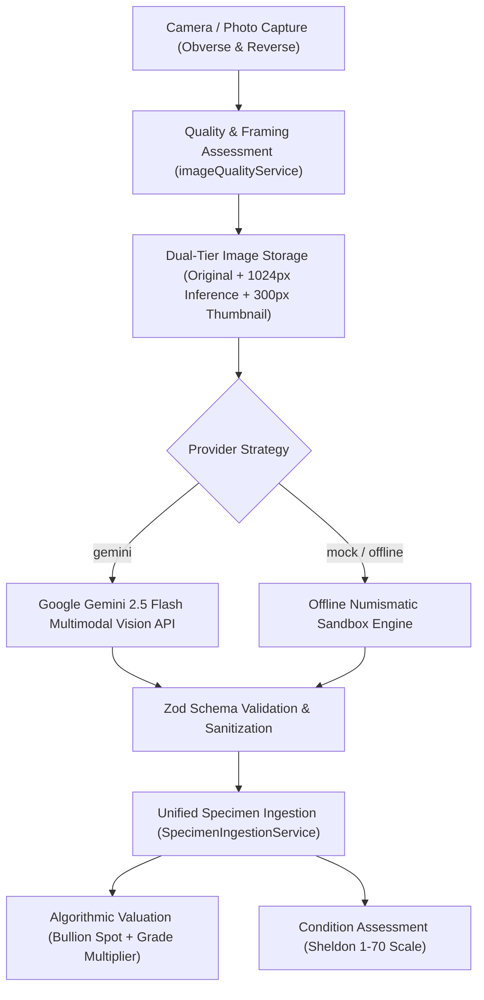

# CoinVault AI Identification & Valuation Pipeline

CoinVault integrates a multimodal computer vision and numismatic estimation pipeline designed for accuracy, provenance transparency, and error resilience.

---

## 1. End-to-End Identification Pipeline



---

## 2. Image Processing & Quality Analysis

### 2.1 Dual-Tier Image Management (`imageProcessor.ts`)
Camera sensors on modern smartphones capture photos between 12MB and 25MB. Uploading raw files causes severe network latency, memory spikes, and potential API payload rejections:

1. **Original Photo**: Persisted uncompressed to permanent local storage (`coinvault_images/`) and linked in `coin_images.original_image_path`.
2. **AI Inference Image**: Scaled to max dimension **1024px** at **0.8 JPEG quality**. Base64 payload is reduced from **~15MB to ~250KB**, yielding a 30x faster upload time without sacrificing numismatic legend or mint mark legibility.
3. **Thumbnail Image**: Scaled to **300px** at **0.75 JPEG quality** for 60fps inventory grid scrolling.

### 2.2 Quality Heuristics (`imageQuality.ts`)
Rather than relying only on file size, `imageQualityService` evaluates:
- **Framing & Aspect Ratio**: Calculates aspect ratio (`width / height`). Warns if the coin is off-center or has an extreme aspect ratio (ideal is 0.75 to 1.33 for circular coins).
- **Resolution**: Flags images under 400px as insufficient for mint mark or date resolution.
- **Compression Density (Bytes-per-pixel)**: Low bytes-per-pixel (`< 0.04`) indicates heavy JPEG compression artifacts or lens softness (blur).
- **Lighting Dynamics**: Detects underexposed photos in low dynamic ranges.

---

## 3. Multimodal Vision Integration (`geminiProvider.ts`)

CoinVault uses Google's `gemini-2.5-flash` model with strict system instructions and structured JSON output:

### 3.1 Error Classification & Resilience
Network and inference failures are categorized into explicit typed errors:
- `GeminiAuthError`: HTTP 401 / 403. Prompts user to check API key in Settings.
- `GeminiRateLimitError`: HTTP 429. Informs user to pause before the next scan.
- `GeminiServiceError`: HTTP 500 / 503 / 504 or network abort. Includes a **25-second AbortController timeout** preventing indefinite UI hangs.
- `GeminiParsingError`: Malformed JSON or candidate omission. Logs the raw text for debugging and prevents crashes.

### 3.2 Structured Output Schema
The response is strictly validated at runtime with Zod:
```typescript
export const CoinIdentificationResultSchema = z.object({
  country: z.string(),
  denomination: z.string(),
  year: z.number().nullable().optional(),
  year_start: z.number().nullable().optional(),
  year_end: z.number().nullable().optional(),
  currency: z.string().nullable().optional(),
  issuing_authority: z.string().nullable().optional(),
  ruler: z.string().nullable().optional(),
  mint: z.string().nullable().optional(),
  mint_mark: z.string().nullable().optional(),
  metal: z.string().nullable().optional(),
  coin_type: z.string(),
  coin_series: z.string().nullable().optional(),
  historical_period: z.string().nullable().optional(),
  shape: z.string().default('Round'),
  edge_type: z.string().default('Reeded'),
  diameter_mm: z.number().nullable().optional(),
  weight_g: z.number().nullable().optional(),
  obverse_description: z.string().nullable().optional(),
  reverse_description: z.string().nullable().optional(),
  catalog_references: z.array(z.string()).default([]),
  confidence: z.object({
    overall: z.number().min(0).max(1),
    country: z.number().min(0).max(1),
    denomination: z.number().min(0).max(1),
    year: z.number().min(0).max(1),
    mint: z.number().min(0).max(1).optional(),
    metal: z.number().min(0).max(1).optional(),
    series: z.number().min(0).max(1).optional(),
  }),
  alternative_identifications: z.array(z.any()).default([]),
  uncertain_attributes: z.array(z.string()).default([]),
  numismatic_notes: z.string().nullable().optional(),
});
```

---

## 4. Valuation Engine & Bullion Spot Index

To ensure data integrity and avoid misleading users:
- **No Fabricated Auction Records**: CoinVault previously generated mock auction sale dates. This was removed. All estimates are now clearly attributed as algorithmic benchmark ranges based on grade and precious metal content.
- **Configurable Bullion Pricing**: Users can calibrate gold, silver, platinum, palladium, and copper spot prices directly in `useSettingsStore`. Default prices:
  - Gold: \$85.00 / gram (~$2,640 / troy oz)
  - Silver: \$1.05 / gram (~$32.60 / troy oz)
  - Platinum: \$31.00 / gram
  - Palladium: \$33.00 / gram
- **Grade Multiplier**: Scales baseline numismatic catalog values using the Sheldon 70-point scale:
  - MS65–MS70: 3.5x – 6.0x multiplier
  - MS60–MS64 (Uncirculated): 2.4x multiplier
  - AU50–AU58 (About Uncirculated): 1.6x multiplier
  - XF40–XF45 (Extremely Fine): 1.25x multiplier
  - VF20–VF35 (Very Fine): 1.0x baseline
- **Melt Value vs. Collector Replacement Value**: Intrinsic metal value is computed independently. If bullion value exceeds baseline numismatic value (as in gold sovereigns or silver bullion coins), the valuation reflects the precious metal value plus an appropriate collector premium.
