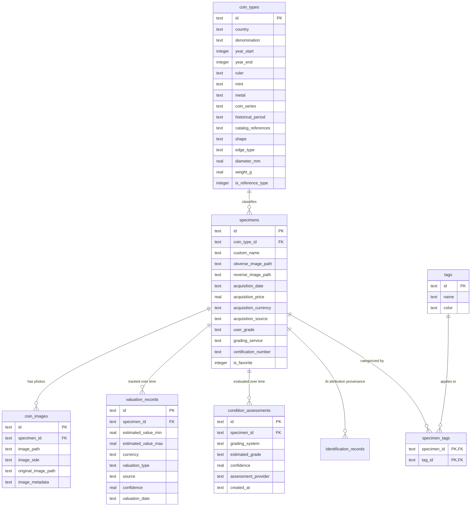

# CoinVault Relational Data Model

CoinVault employs a normalized, local-first SQLite relational schema designed around numismatic reality.

---

## 1. Core Numismatic Distinction: CoinType vs. Physical Specimen

A critical architectural principle of CoinVault is the distinction between an abstract **Coin Type** and an individual **Physical Specimen**:

- **Coin Type (`coin_types`)**: The catalog classification of a coin model (e.g. *1881 Morgan Silver Dollar minted in San Francisco*). It contains theoretical specifications: issuing country, denomination, design descriptions, metal purity, diameter, standard weight, and catalog references.
- **Specimen (`specimens`)**: An actual physical coin owned by a collector. It references a `coin_type_id` and records physical attributes: user grade, certification number, acquisition price, condition notes, photos, and personal provenance.

A collector may own three specimens of the same Coin Type, each with different grades (e.g., VF30, AU55, MS65), different purchase prices, and independent valuation histories.

---

## 2. Entity Relationship Diagram



---

## 3. Schema Definitions

### 3.1 `coin_types`
Master numismatic catalog entries.
```sql
CREATE TABLE IF NOT EXISTS coin_types (
  id TEXT PRIMARY KEY,
  country TEXT NOT NULL,
  denomination TEXT NOT NULL,
  year_start INTEGER,
  year_end INTEGER,
  ruler TEXT,
  mint TEXT,
  metal TEXT,
  coin_series TEXT,
  historical_period TEXT,
  catalog_references TEXT DEFAULT '[]',
  obverse_description TEXT,
  reverse_description TEXT,
  shape TEXT DEFAULT 'Round',
  edge_type TEXT DEFAULT 'Reeded',
  diameter_mm REAL,
  weight_g REAL,
  is_reference_type INTEGER DEFAULT 0,
  created_at TEXT NOT NULL,
  updated_at TEXT NOT NULL
);
```

### 3.2 `specimens`
Physical coins in the user's collection.
```sql
CREATE TABLE IF NOT EXISTS specimens (
  id TEXT PRIMARY KEY,
  coin_type_id TEXT NOT NULL,
  custom_name TEXT,
  obverse_image_path TEXT,
  reverse_image_path TEXT,
  additional_images TEXT DEFAULT '[]',
  acquisition_date TEXT,
  acquisition_price REAL,
  acquisition_currency TEXT DEFAULT 'USD',
  acquisition_source TEXT,
  seller TEXT,
  auction_reference TEXT,
  user_grade TEXT,
  grading_service TEXT DEFAULT 'Raw',
  certification_number TEXT,
  condition_notes TEXT,
  notes TEXT,
  is_favorite INTEGER DEFAULT 0,
  created_at TEXT NOT NULL,
  updated_at TEXT NOT NULL,
  FOREIGN KEY (coin_type_id) REFERENCES coin_types(id) ON DELETE RESTRICT
);
```

### 3.3 `coin_images`
Dual-tier image storage references.
```sql
CREATE TABLE IF NOT EXISTS coin_images (
  id TEXT PRIMARY KEY,
  specimen_id TEXT NOT NULL,
  image_path TEXT NOT NULL,            -- Fast thumbnail / display image
  image_side TEXT NOT NULL,            -- 'obverse' | 'reverse' | 'detail'
  original_image_path TEXT,           -- Uncompressed high-res master photo
  image_metadata TEXT,                -- Dimensions, aspect ratio, inference URI
  created_at TEXT NOT NULL,
  FOREIGN KEY (specimen_id) REFERENCES specimens(id) ON DELETE CASCADE
);
```

### 3.4 `valuation_records`
Historical market and intrinsic valuations.
```sql
CREATE TABLE IF NOT EXISTS valuation_records (
  id TEXT PRIMARY KEY,
  specimen_id TEXT NOT NULL,
  estimated_value_min REAL NOT NULL,
  estimated_value_max REAL NOT NULL,
  currency TEXT NOT NULL DEFAULT 'USD',
  valuation_type TEXT NOT NULL DEFAULT 'numismatic_market',
  source TEXT NOT NULL,
  comparable_sales TEXT DEFAULT '[]',
  confidence REAL NOT NULL,
  valuation_date TEXT NOT NULL,
  notes TEXT,
  FOREIGN KEY (specimen_id) REFERENCES specimens(id) ON DELETE CASCADE
);
```

### 3.5 `condition_assessments`
Condition and preservation grading history.
```sql
CREATE TABLE IF NOT EXISTS condition_assessments (
  id TEXT PRIMARY KEY,
  specimen_id TEXT NOT NULL,
  grading_system TEXT NOT NULL DEFAULT 'sheldon_70',
  estimated_grade TEXT NOT NULL,
  estimated_grade_min TEXT,
  estimated_grade_max TEXT,
  numerical_grade_min INTEGER,
  numerical_grade_max INTEGER,
  observations TEXT DEFAULT '[]',
  confidence REAL NOT NULL,
  assessment_provider TEXT NOT NULL,
  is_certified INTEGER DEFAULT 0,
  explanation TEXT,
  created_at TEXT NOT NULL,
  FOREIGN KEY (specimen_id) REFERENCES specimens(id) ON DELETE CASCADE
);
```

### 3.6 `identification_records`
Provenance log of AI identification model predictions.
```sql
CREATE TABLE IF NOT EXISTS identification_records (
  id TEXT PRIMARY KEY,
  specimen_id TEXT,
  model_provider TEXT NOT NULL,
  model_version TEXT NOT NULL,
  raw_response TEXT,
  normalized_result TEXT NOT NULL,
  confidence_scores TEXT NOT NULL,
  alternative_identifications TEXT DEFAULT '[]',
  uncertain_attributes TEXT DEFAULT '[]',
  user_confirmed INTEGER DEFAULT 0,
  created_at TEXT NOT NULL,
  FOREIGN KEY (specimen_id) REFERENCES specimens(id) ON DELETE SET NULL
);
```

---

## 4. Query Performance Indexes

CoinVault leverages composite indexes to guarantee sub-millisecond query performance:

- `idx_valuation_specimen_date_desc ON valuation_records(specimen_id, valuation_date DESC)`: Eliminates full-table grouping when querying the latest valuation of a specimen.
- `idx_condition_specimen_created_desc ON condition_assessments(specimen_id, created_at DESC)`: Rapid retrieval of the most recent condition assessment.
- `idx_coin_types_country_denom_year ON coin_types(country, denomination, year_start)`: Fast deduplication lookup in `coinTypeRepository.findExisting`.
- `idx_coin_images_specimen_side ON coin_images(specimen_id, image_side)`: Rapid retrieval of obverse/reverse photos.
- `idx_specimens_coin_type ON specimens(coin_type_id)`: Foreign key index for catalog cross-references.
- `idx_specimens_fav ON specimens(is_favorite)`: Filter acceleration for favorite coins.
